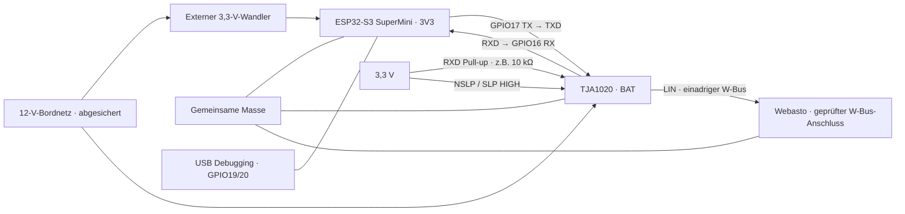

# Verdrahtung: ESP32-S3 und TJA1020

## Logischer Anschlussplan

| ESP32 / Versorgung | TJA1020-Funktion | Hinweis |
|---|---|---|
| GPIO17 TX | TXD (Eingang) | Nicht an LIN anschließen |
| GPIO16 RX | RXD (Ausgang, Open Drain) | Pull-up ausschließlich nach 3,3 V |
| 3,3 V | NSLP / SLP | dauerhaft High für normalen Betrieb; Modulbeschriftung prüfen |
| abgesicherte Batteriespannung | BAT | Transceiver-Busversorgung, nicht 3,3 V |
| GND | GND | mit ESP32 und Heizgerät gemeinsam |
| Heizgerät W-Bus | LIN | keine Verbindung zu CAN-H/CAN-L |
| keine ESP32-Verbindung | INH | kein 3,3-V-Logiksignal; unbenutzt lassen, wenn nicht benötigt |

Die Tabelle nennt **Signalfunktionen**, keine möglicherweise vertauschten TX/RX-Aufdrucke eines unbekannten Moduls. Beim nackten TJA1020 mit SO8-Gehäuse gilt laut NXP: 1 RXD, 2 NSLP, 3 NWAKE, 4 TXD, 5 GND, 6 LIN, 7 BAT, 8 INH. NWAKE ist ein batteriebezogener Eingang; unbenutzte Beschaltung nach Datenblatt vorsehen, nicht mit einem ESP32-GPIO verbinden. Abblockung, Schutzbeschaltung und LIN-Terminierung gemäß Datenblatt und vorhandener Modulschaltung prüfen; keine zusätzliche LIN-Master-Terminierung blind parallel zur Webasto setzen.

NXP dokumentiert 3,3-V-kompatible Eingänge und einen Open-Drain-RXD-Ausgang: [TJA1020-Datenblatt](https://www.nxp.com/docs/en/data-sheet/TJA1020.pdf) und [Application Note AN00093](https://www.nxp.com/docs/en/application-note/AN00093.pdf). Ein Modul mit festem RXD-Pull-up auf 5 V muss entsprechend angepasst werden; ESP32-Eingänge sind nicht 5-V-tolerant. Der 10-kΩ-Wert ist ein Ausgangspunkt für einen kurzen Prüfaufbau und anhand Flanken/Kabellast zu prüfen, keine Freigabe eines beliebigen Moduls.

## ESP32-S3 SuperMini

- 3V3 aus einem externen ausreichend belastbaren, geschützten Wandler. Bordnetztransienten, Verpolung und Sicherungen müssen durch die Hardware berücksichtigt werden.
- GPIO16/17 sind die Softwarevorgaben. SuperMini-Ausführungen unterscheiden sich; GPIO17 muss tatsächlich erreichbar sein. Andernfalls TX in der Weboberfläche auf einen herausgeführten freien Pin legen und neu starten.
- GPIO19/20 sind für natives USB reserviert. Boot-Straps und Flash/PSRAM-Pins werden in der GPIO-Validierung ausgeschlossen. Die freigegebene Auswahl beweist nicht, dass jeder Pin auf jeder Platine herausgeführt ist.
- Standardprofil: 4 MB Flash, kein aktiviertes PSRAM, kein Display/LED-Pin automatisch belegt.
- USB und externe 3,3-V-Versorgung nur zusammen nutzen, wenn die konkrete Platine die Versorgung korrekt entkoppelt; keinen unbekannten Regler rückspeisen.

## Webasto

Den **konkreten** Schaltplan des Heizgeräts verwenden, W-Bus-Leitung und Hauptversorgung eindeutig identifizieren. Es wird keine universelle Stecker-/Pinnummer für alle Thermo Top Z/C-D angegeben. Bei manchen OEM-Versionen unterscheidet sich die Ansteuerung. Es gibt hier weder CAN noch ein Gateway. Weitere W-Bus-Bedienteile für diesen Aufbau als Master trennen.

Regulärer Stopp erfolgt über das Protokoll, nicht durch Trennen der Heizgeräteversorgung. Der Nachlauf muss möglich bleiben. Erste Brennerprüfung nur mit korrekt aufgebautem Kühlmittel-/Kraftstoff-/Abgassystem im Freien; Software und Modelltests ersetzen diese Voraussetzungen nicht.
